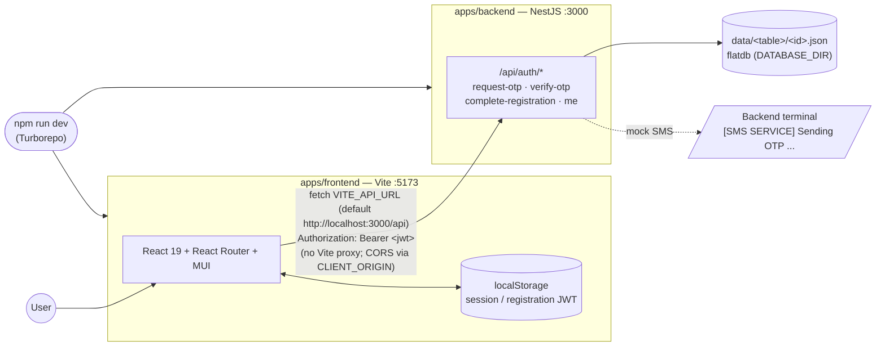
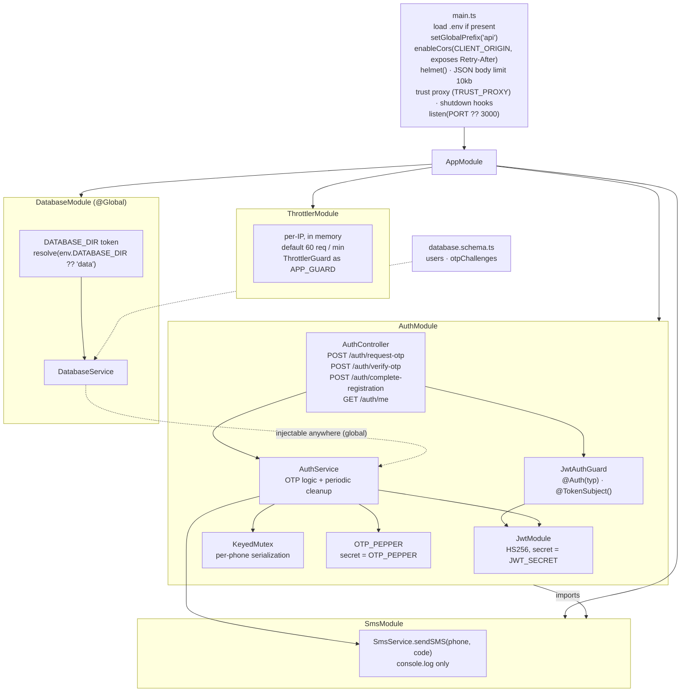
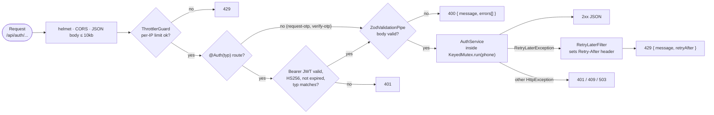
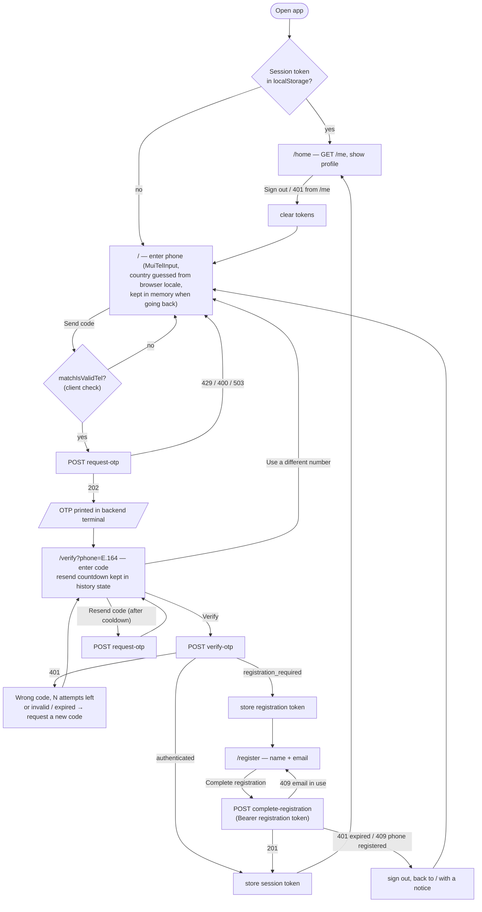
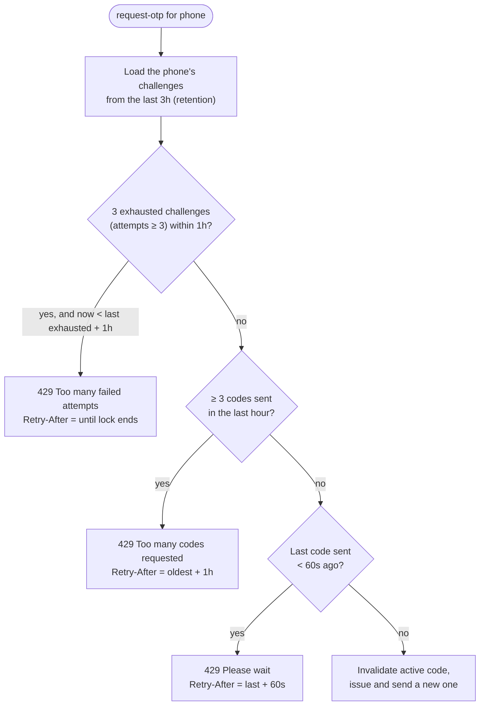
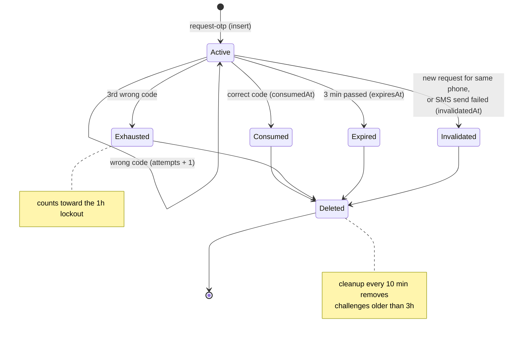
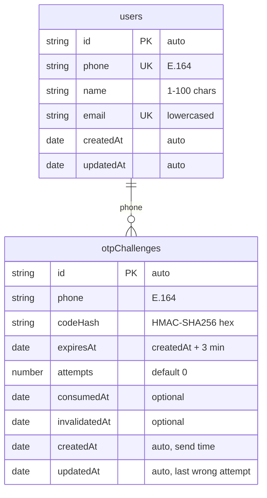
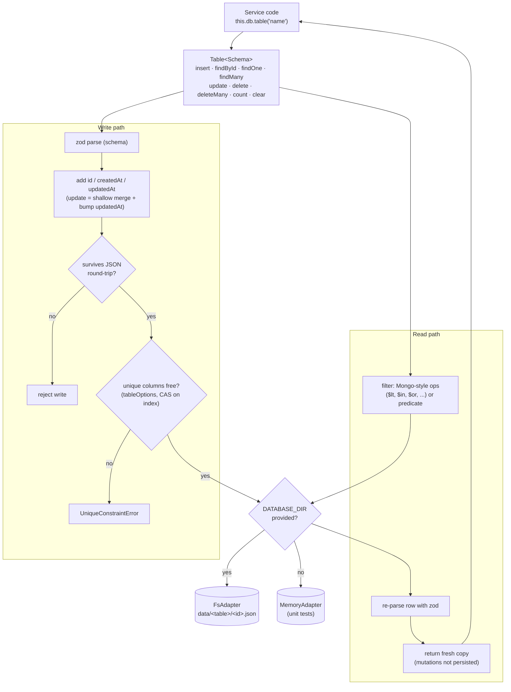
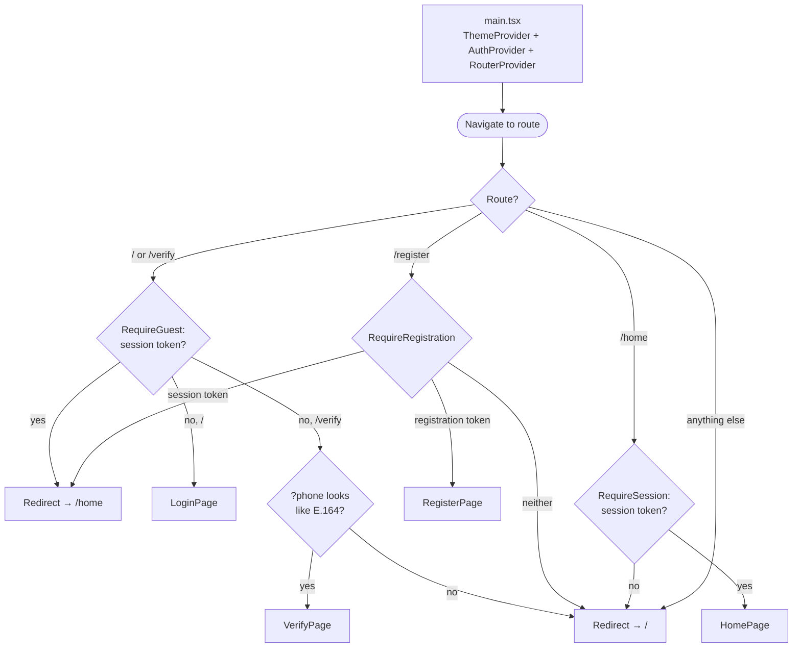

# Application Flow

How the OTP login / registration app fits together, as Mermaid diagrams. Everything here describes the code as it is today; policy numbers come from `apps/backend/src/auth/auth.config.ts`.

---

## 1. System overview

## 2. Backend module graph

`JWT_SECRET` and `OTP_PEPPER` go through `secretFromEnv`: required when `NODE_ENV=production`, otherwise a random per-process value is used (with a warning), so tokens and pending codes don't survive a restart.

## 3. HTTP request pipeline

What every auth request passes through before and after `AuthService`.

Per-route IP limits (`@Throttle`, on top of the global 60/min): `request-otp` 5/min, `verify-otp` 10/min, `complete-registration` 5/min.

## 4. API reference

| Endpoint | Auth | Body | Success | Errors |
| --- | --- | --- | --- | --- |
| `POST /api/auth/request-otp` | — | `{ phone }` (international, `+` required) | `202 { phone, expiresIn: 180, resendIn: 60 }` — `phone` normalized to E.164 | `400` invalid phone · `429 { retryAfter }` cooldown / hourly cap / lockout · `503` SMS failed |
| `POST /api/auth/verify-otp` | — | `{ phone, code }` (6 digits) | `200 { status: 'authenticated', token, user }` or `200 { status: 'registration_required', registrationToken }` | `400` invalid input · `401 { message, attemptsLeft? }` |
| `POST /api/auth/complete-registration` | Bearer **registration** | `{ name, email }` | `201 { token, user }` | `400` · `401` bad/expired ticket · `409` phone already registered / email in use |
| `GET /api/auth/me` | Bearer **session** | — | `200 { user }` | `401` |

`user` is always the public shape `{ id, phone, name, email }`. `request-otp` responds the same whether or not the phone has an account.

## 5. User journey

## 6. End-to-end sequence

```mermaid
sequenceDiagram
    autonumber
    actor U as User
    participant P as React pages
    participant C as AuthController
    participant S as AuthService
    participant D as DatabaseService
    participant M as SmsService

    rect rgba(127,127,127,0.08)
    note over U,M: Step 1 — request OTP (inside mutex for phone)
    U->>P: enter phone, "Send code"
    P->>C: POST /api/auth/request-otp { phone }
    C->>S: requestOtp(E.164 phone)
    S->>D: otpChallenges.findMany(phone, created within retention)
    S->>S: assertCanSend → lockout / hourly cap / cooldown (else 429)
    S->>D: update active challenges { invalidatedAt: now }
    S->>S: code = randomInt, 6 digits<br/>codeHash = HMAC-SHA256(pepper, phone:code)
    S->>D: otpChallenges.insert({ phone, codeHash, expiresAt: now + 3 min })
    S->>M: await sendSMS(phone, code)
    alt SMS fails
        S->>D: update challenge { invalidatedAt }
        C-->>P: 503
    else sent
        M-->>M: console.log [SMS SERVICE] Sending OTP ...
        C-->>P: 202 { phone, expiresIn, resendIn }
        P->>P: navigate /verify?phone=... with state { resendAt }
    end
    end

    rect rgba(127,127,127,0.08)
    note over U,M: Step 2 — verify OTP (inside mutex for phone)
    U->>P: enter code, "Verify"
    P->>C: POST /api/auth/verify-otp { phone, code }
    C->>S: verifyOtp(phone, code)
    S->>D: newest active challenge for phone
    alt no active challenge
        C-->>P: 401 Invalid or expired code
    else hash mismatch (timingSafeEqual)
        S->>D: update { attempts + 1 }
        C-->>P: 401 { attemptsLeft }
    else code matches
        S->>D: update { consumedAt: now }
        S->>D: users.findOne({ phone })
        alt existing user
            S->>S: sign session JWT (sub = user id, 1h)
            C-->>P: 200 { status: authenticated, token, user }
            P->>P: signIn(token), navigate /home
        else new user
            S->>S: sign registration JWT (sub = phone, 15m)
            C-->>P: 200 { status: registration_required, registrationToken }
            P->>P: startRegistration(token), navigate /register
        end
    end
    end

    rect rgba(127,127,127,0.08)
    note over U,M: Step 3 — complete registration (new users only)
    U->>P: enter name + email
    P->>C: POST /api/auth/complete-registration { name, email }<br/>Authorization: Bearer registrationToken
    C->>C: JwtAuthGuard (typ = registration), phone = token sub
    C->>S: completeRegistration(phone, { name, email })
    S->>D: users.findOne by phone, then by email
    alt either exists
        C-->>P: 409
    else free
        S->>D: users.insert({ phone, name, email })
        note right of D: unique index backstop:<br/>UniqueConstraintError → 409
        S->>S: sign session JWT
        C-->>P: 201 { token, user }
        P->>P: signIn(token), navigate /home
    end
    end

    rect rgba(127,127,127,0.08)
    note over U,M: Step 4 — home
    P->>C: GET /api/auth/me (Bearer session)
    C->>S: getUser(token sub)
    S->>D: users.findById
    C-->>P: 200 { user } or 401 (→ signOut)
    end
```

## 7. Per-phone send limits (`assertCanSend`)

Checked in this order on every `request-otp`; the first that applies wins.

Combined with 3 attempts per code, this allows at most 9 guesses per phone per hour; the per-IP throttles apply on top.

## 8. OTP challenge lifecycle

A challenge is **active** while it is not consumed, not invalidated, not expired and has attempts left. Only the newest active one is checked.

## 9. Tokens

| | `session` | `registration` |
| --- | --- | --- |
| Issued by | `verify-otp` (existing user), `complete-registration` | `verify-otp` (unknown phone) |
| `sub` | user id | verified E.164 phone |
| Lifetime | 1h | 15m |
| Accepted by | `GET /me` | `POST /complete-registration` |
| localStorage key | `auth.sessionToken` | `auth.registrationToken` |

Both are HS256 JWTs with a `typ` claim; `JwtAuthGuard` rejects a token of the wrong type, so one can't stand in for the other. The phone for registration is taken from the token, never from the body, and a ticket works only once (afterwards the phone is registered → 409).

On the frontend `AuthProvider` holds at most one of the two: `signIn` stores the session and clears the ticket, `startRegistration` does the reverse, `signOut` clears both. Tokens whose `exp` has passed are dropped on load. Sessions are stateless and can't be revoked before expiry.

## 10. Data model

Declared in `database.schema.ts`. `id`, `createdAt` and `updatedAt` are added by the database; dates use `z.coerce.date()`.

Challenges exist before any `users` row (first-time sign-up), so the relation matches on the phone value; there is no hard foreign key. `users.phone` and `users.email` are unique via `tableOptions`.

## 11. Database layer

`DatabaseService` builds one typed `Table` per entry in `databaseSchema`. It uses the file adapter when `DATABASE_DIR` is provided (by `DatabaseModule`) and an in-memory adapter otherwise (a testing module that provides `DatabaseService` directly).

## 12. Frontend routes & guards

The guards only steer navigation; the server enforces every rule itself. All screens share `AuthLayout`, whose stepper shows Phone (0) → Verify (1) → Profile (2); `HomePage` passes step 3 so all steps show as done.

## 13. Configuration

| Variable | App | Default | Purpose |
| --- | --- | --- | --- |
| `PORT` | backend | `3000` | HTTP port |
| `CLIENT_ORIGIN` | backend | `http://localhost:5173` | CORS origin |
| `DATABASE_DIR` | backend | `data` | flatdb folder (relative to backend cwd) |
| `JWT_SECRET` | backend | random per process (dev) | signs session / registration JWTs |
| `OTP_PEPPER` | backend | random per process (dev) | HMAC key for OTP hashes |
| `NODE_ENV` | backend | — | `production` makes the two secrets required |
| `TRUST_PROXY` | backend | unset | Express `trust proxy`, so rate limits see the client IP |
| `VITE_API_URL` | frontend | `http://localhost:3000/api` | API base URL |

The backend loads `apps/backend/.env` on start if it exists (shell variables win); see the `.env.example` files.
