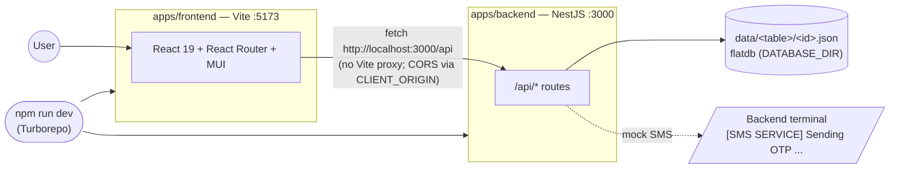
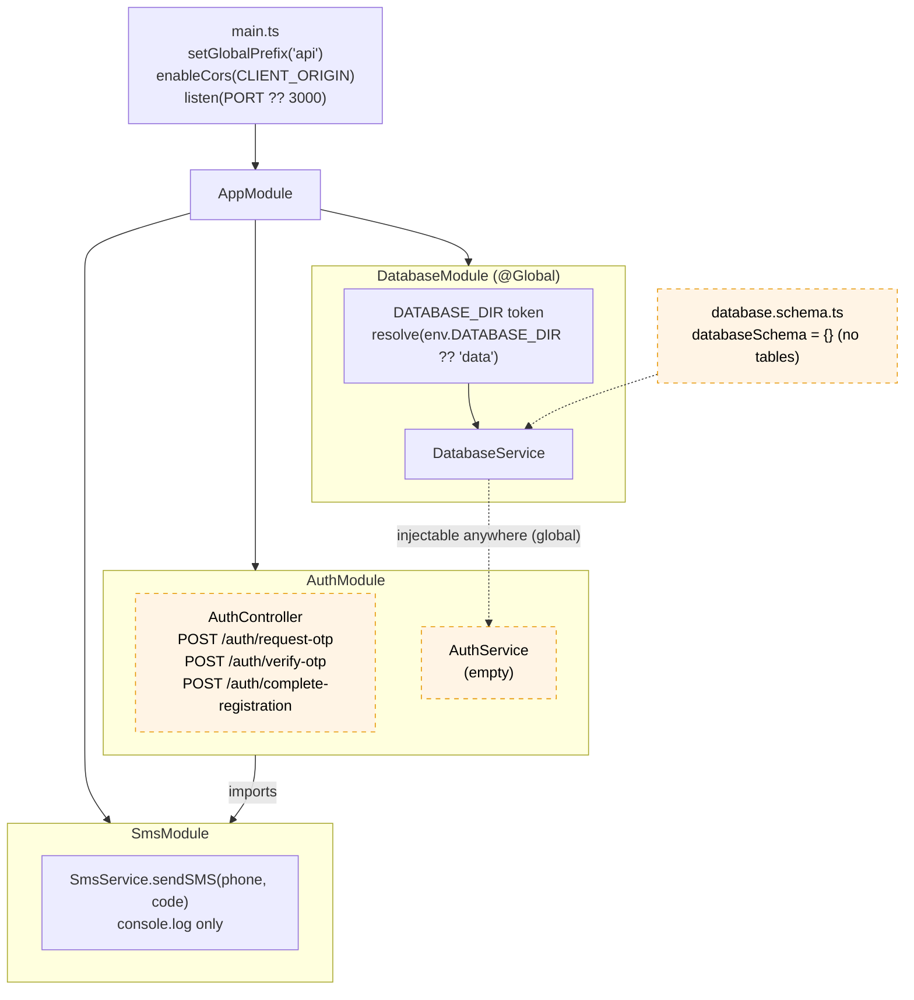
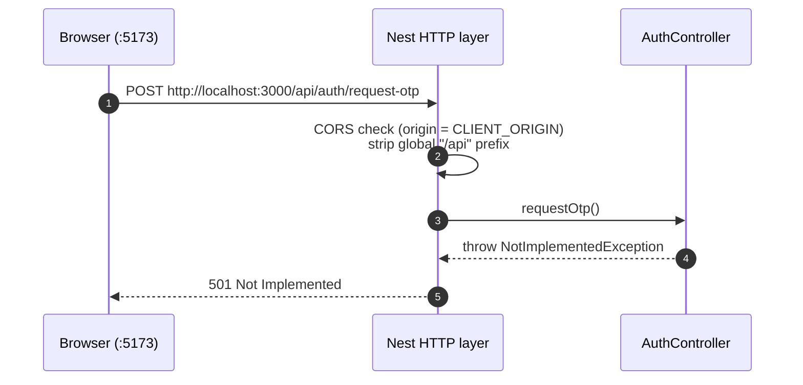
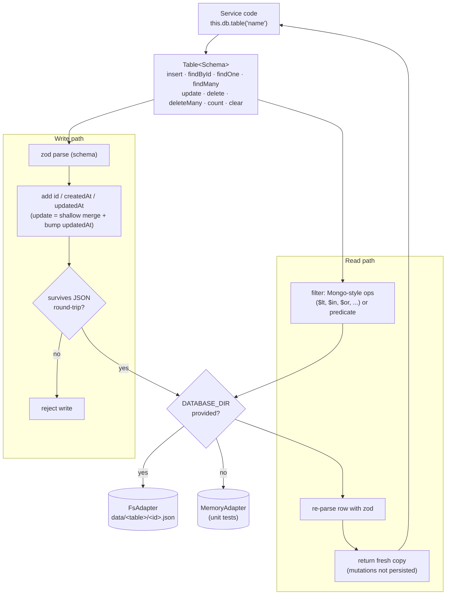
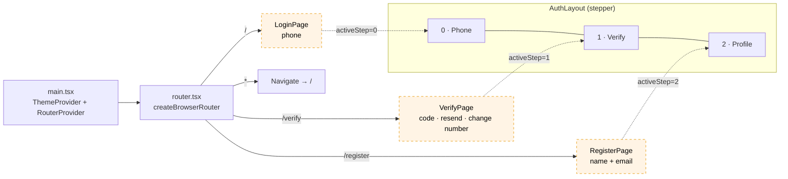
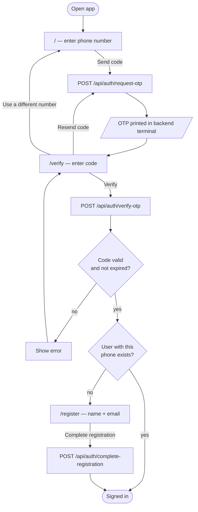
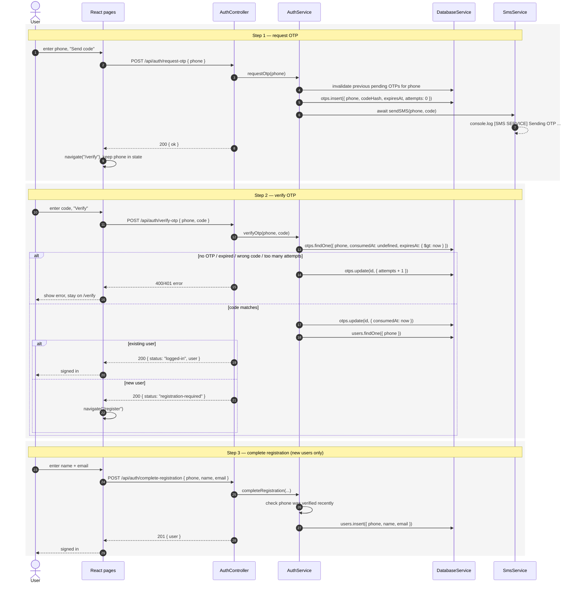
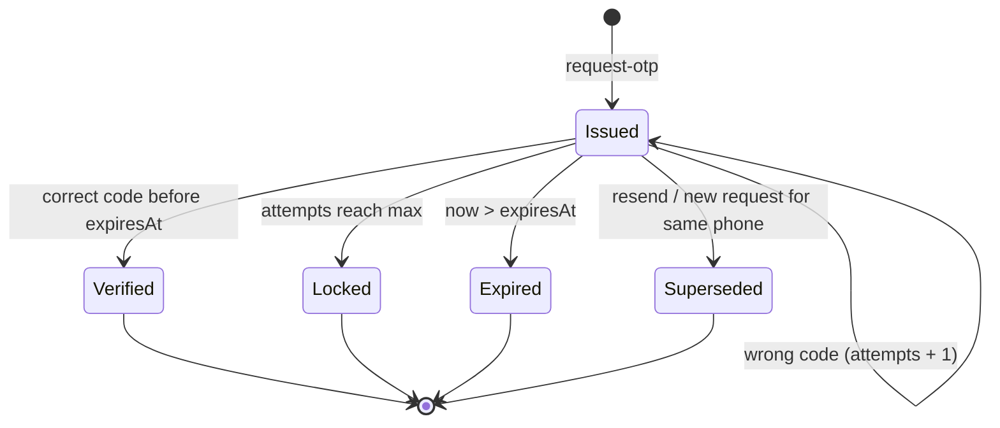
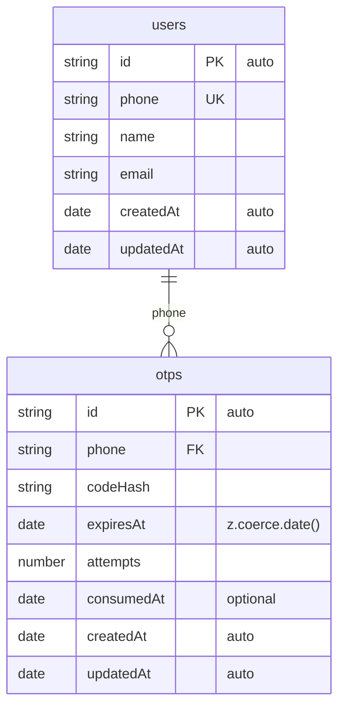
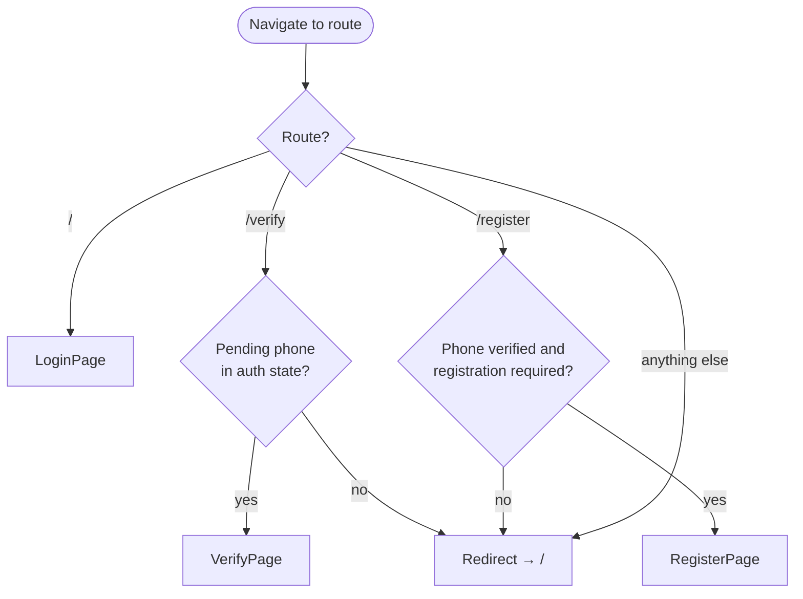

# Application Flow

How the OTP login / registration app fits together, as Mermaid diagrams.

The diagrams come in two parts:

- **Part 1 — Current**: what exists in the code today. Stubbed pieces are drawn with dashed, amber-filled nodes.
- **Part 2 — Target**: the intended OTP flow that the `TODO: Candidate to implement` markers (see `TODO.md`) should produce. Table names, payload shapes and guard rules there are **suggestions**, not existing code.

---

## Part 1 — Current architecture

### 1. System overview

### 2. Backend module graph

### 3. Request lifecycle today

Every auth endpoint is a stub, so any call currently ends in `501`.

### 4. Database layer

`DatabaseService` builds one typed `Table` per entry in `databaseSchema`. It uses the file adapter when `DATABASE_DIR` is provided (by `DatabaseModule`) and an in-memory adapter otherwise (a testing module that provides `DatabaseService` directly).

### 5. Frontend routes

The pages are UI only right now: forms don't submit anywhere, there are no route guards, and nothing is shared between steps.

---

## Part 2 — Target OTP flow *(to implement)*

### 6. User journey *(Target)*

### 7. End-to-end sequence *(Target)*

Payloads are suggestions; no DTOs exist yet.

### 8. OTP lifecycle *(Target)*

### 9. Proposed data model *(Target)*

These would be added to `databaseSchema` in `database.schema.ts`. `id`, `createdAt` and `updatedAt` are added automatically and must **not** be declared. Date columns use `z.coerce.date()`.

`otps.phone` can exist before any `users` row (a first-time sign-up), so the relation matches on the phone value; there is no hard foreign key.

### 10. Route guards *(Target)*

